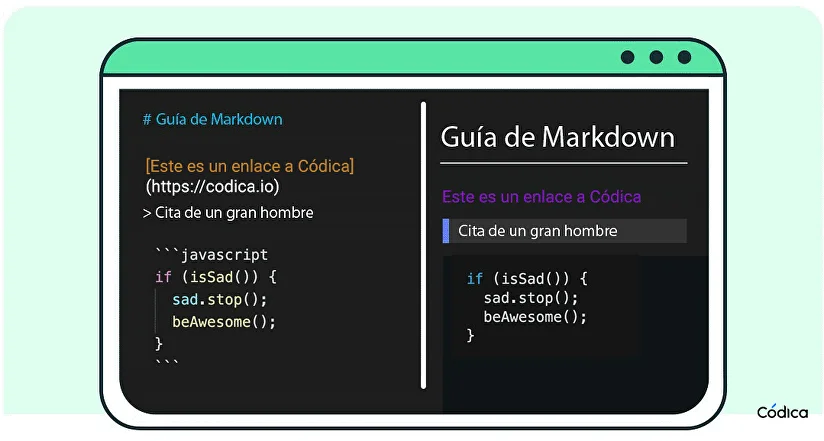

# Guía Completa de Markdown

Markdown es un lenguaje de marcado ligero creado para que puedas escribir texto con formato utilizando cualquier editor de texto plano. Es fácil de leer, rápido de escribir y se ha convertido en el estándar para plataformas como GitHub, Reddit, Discord y miles de blogs.

---

## 1. Encabezados (Títulos)

Para crear encabezados, utiliza el símbolo de almohadilla (`#`) seguido de un espacio. La cantidad de almohadillas determina el nivel del encabezado (del 1 al 6).

# Título 1 (El más grande)
## Título 2
### Título 3
#### Título 4
##### Título 5
###### Título 6 (El más pequeño)

## 2. Formato de Texto básico

Puedes enfatizar el texto de manera muy sencilla utilizando asteriscos (`*`) o guiones bajos (`_`), así como virgulillas (`~`) para tachar.

| Formato | Sintaxis Markdown | Resultado Visual |
|---|---|---|
| **Negrita** | `**texto en negrita**` | **texto en negrita** |
| *Cursiva* | `*texto en cursiva*` | *texto en cursiva* |
| ***Negrita y Cursiva*** | `***ambos estilos***` | ***ambos estilos*** |
| Tachado | `~~texto tachado~~` | ~~texto tachado~~ |

## 3. Listas

Crear listas ordenadas y desordenadas es muy intuitivo.

**Listas Desordenadas**
Puedes usar un guion (`-`), un asterisco (`*`) o un signo de suma (`+`) seguido de un espacio.

- Elemento 1
- Elemento 2
- Elemento 3

**Listas Ordenadas**
Escribe un número seguido de un punto y un espacio. (Nota: Markdown ajustará los números automáticamente aunque te equivoques en el orden numérico en el código fuente).

1. Primer paso
2. Segundo paso
3. Tercer paso

**Listas de Tareas (Checklists)**
Muy útiles para llevar seguimiento de actividades.

- [x] Tarea completada
- [ ] Tarea pendiente

## 4. Enlaces e Imágenes

La sintaxis para enlaces e imágenes es casi idéntica, la única diferencia es que las imágenes llevan un signo de exclamación `!` al principio.

**Enlaces**
Escribe el texto visible entre corchetes `[]` y la URL entre paréntesis `()`.
[Visita Google](https://www.google.com)

**Imágenes**

* **Alternativa 1:**

```

```


* **Alternativa 2:**

```

```


## 5. Citas y Código

**Citas en bloque (Blockquotes)**
Ideales para citar texto de otra persona o resaltar información importante. Usa el signo de mayor que (`>`).

> "La simplicidad es la máxima sofisticación." - Leonardo da Vinci

* **Código en línea**

Para resaltar comandos o palabras clave dentro de un párrafo, usa acentos graves (`` ` ``).

Por ejemplo: Para imprimir texto en pantalla usa el comando `print()`.

* **Bloques de código**

Para fragmentos de código de varias líneas, encierra el bloque entre tres acentos graves (```). Puedes especificar el lenguaje de programación al inicio para que Markdown aplique colores al código.

```python
def saludar():
    print("¡Hola, mundo!")
```

## 6. Tablas 


|    Pepe1  |    Pepe2  |   Pepe3   |        
|-----------|-----------|-----------|
|  juancho  |           |           |     
|  juancho2 |           |           |      
|  juancho3 |           |           |    
|  juancho4 |           |           |      
|  juancho5 |           |           |      